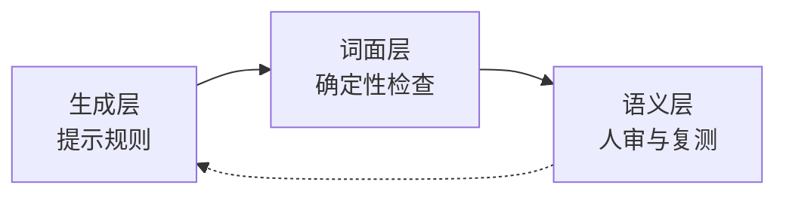

# FuckAIWords

可移植的中文「去 AI 味」Agent：载入后**先探测本机可接入的 bot 或 AI**，问清目标，装一份表达层，用一百问采集真实回答，经**人工审核**后把纠正回填到目标。

减少客服套话、空泛复述、固定起手和机械接梗，保留原有性格、事实、工具能力与权限边界。不要求伪装真人，也不宣称能通过某个检测器。

## 本仓库包含什么

| 内容 | 是否包含 |
| --- | --- |
| 一百个问题与审核考点 | **包含** |
| 表达规则内核、装配与回填工具 | **包含** |
| 来源证据与一致性对照 | **包含** |
| 作者在本地采到的模型回答 | **不包含** |
| 作者的审核结论、回填示例 | **不包含** |

**只发问题是有意的。** 回答由特定模型、特定人设、特定温度生成：把它放进包里，新用户会拿别人的 bot 的回答当基准，也可能把作者本地的对话带出去。所以本包只提供固定输入，回答必须在你自己的目标上采集。

`runs/` 已加入 `.gitignore`，本机采集结果与审核导出不会随包分发。想先看题可以打开 [100问预览.html](100问预览.html)（只含问题，不能导出审核），或读 [evaluation/100问.md](evaluation/100问.md)。

**装上去的代价**：系统提示会变长，单次输入 token 明显增加，**缓存命中量会下降**，账单会涨。下降多少取决于装配点前面有没有动态内容——表达层落在记忆、时间之后时，它自己完全不进缓存。机制、两组实测数据、换算方法和自检脚本都在 [特别说明.md](特别说明.md)。

## 30 秒开始

**只需要聊天窗口**：把 [AGENT.md](AGENT.md) 全文贴进去，然后说「帮我接入我的 bot」。它会先问清目标，再给步骤。

**有文件工具的 AI**（Claude Code、Codex、Cursor、NewMax 等）：克隆本仓库，然后对它说：

> 先读 AGENT.md，按流水线执行：探测本机可接入的 bot/AI → 缺信息就问我 → 装配 → 一百问 → 人工审核 → 回填 → 复测。

**作为 skill**：把整个目录复制为 `deai-dialogue`，放进宿主的 skills 目录（如 `~/.newmax/skills/`、`~/.claude/skills/`），再调用 `$deai-dialogue`。

**离线整包**：[portable-deai-agent.zip](portable-deai-agent.zip)，解压即用。

## 原理

### AI 味是默认策略，不是一张词表

模型在没有人设和语境约束时，默认会往"有用且安全"的表面特征上靠：先确认再展开、把具体的事换成抽象复述、给结构和总结、对情绪套安慰模板、对陌生词先拆定义、结尾加一句追问。这套策略在客服场景成立，在朋友聊天里就是 AI 味。

所以去 AI 味改的不是词，是四类决策：**接不接、说多长、先说什么、要不要收尾**。

### 原 bot 的三层设计

这套框架最初跑在一个 QQ bot 里，做法是把表达纪律拆成三层：



| 层 | 管什么 | 为什么放这一层 |
| --- | --- | --- |
| 生成层 | 参与判断、长度、起手、收尾、是否总结 | 只有模型知道这轮该不该接、该说多少 |
| 词面层 | 固定起手、结尾反问、认错收尾、硬接梗、标点密度、连续同开头 | 这些能被正则确定性识别，不该占模型注意力 |
| 语义层 | 这句贴不贴合、是不是又把具体的事说空了 | 正则做不到，只能由人或带语境的判断来做 |

关键取舍是**不把三者混成一张禁词表**。同一个词在不同语境合法性不同：`首先/其次` 在排错步骤里必要，在闲聊里是搭架子；`不是 A 而是 B` 在真实对比里成立，在附和后又反转时才是套句。原 bot 的做法是让能确定判断的归代码，需要语境的归人。

### 可移植版为什么改成"校准期"

原 bot 的机制绑在运行时：插件钩子、发送守卫、表达记忆。搬到别人的 AI 上就不存在这些接口。所以本包把它改成一次性校准：

1. 把生成层规则**通用化**（剥掉平台与角色特定条目），装成一份表达层；
2. 用固定的一百题把"规则有没有被执行"变成可比较的样本；
3. 由人逐条判断哪些回答合格、哪些要改；
4. 把人的判断编译成**带语境的示例**回填，再采一轮对比。

区别在于：原 bot 是**每轮都在线的纪律**，本包是**离线校准 + 一份表达层**。所以默认不拦截任何消息，也不假装自己有发送链路。

### 三条不变量

1. **只缩短，不新增**：修订只能删减，不能塞进新事实、新承诺、新细节。原 bot 用 `validRevision()` 做代码强制；本包写进装配约束，由目标项目自行落实。
2. **明确请求优先**：私聊、被 `@`、正文点名的请求，不因为"不想像客服"而被敷衍或沉默。风格偏好永远低于用户明确要求。
3. **质检失败放行**：风格检查报错时只告警、不阻断聊天。宁可放过一句套话，也不让整段对话卡死。

### 人设优先：只补怎么说，不改是谁

本包带来的是一份**表达层**，不是新角色。目标已有的设定优先于本包任何条目：

| 发生冲突的对象 | 以谁为准 |
| --- | --- |
| 原有性格、说话习惯、口癖 | **原有设定** |
| 原有世界观、背景、人物关系 | **原有设定** |
| 原有能力边界、权限、工具用法 | **原有设定** |
| 原有禁区、安全规则、合规要求 | **原有设定** |
| 本包的表达偏好（长度、起手、收尾、少总结） | 仅在不与以上冲突时生效 |

落到操作上，默认的 `marker` 与 `json-path` 都是**追加**：原文一字不动，只在末尾维护一个 `deai:begin … deai:end` 块；重复安装只替换这个块，不会叠加，也不会重排原内容。安装结果会给出这两个字段，可以直接核对：

- `preserved_original_chars`：原内容保留的字符数
- `persona_policy`：`preserve-existing`（保留）或 `replace-all`（整份丢弃）

`--mode replace` 是唯一会丢弃原设定的模式，结果会标成 `replace-all` 并带 `warning`，**只有在用户明确说"不用管原设定"时才可用**。

装配前必须先读一遍目标的人设，并在回答里列出"将保留哪些设定、只追加什么"。若本包某条与目标人设冲突（例如目标是冷淡简短，而某条示例偏热情），跳过该条，不要反过来改目标设定。

### 一百问为什么必须由人签认

判断"表达是否改善"需要三样东西同时成立：固定输入、可比样本、可信判据。

- 一百题分十类各十题，覆盖最容易暴露 AI 味的场景：日常接话、情绪与倾听、玩笑与纠错、解释与未知、技术求助、工具与回执、身份与归属、改写与格式、参与与边界、连续会话。
- 每题带 `focus`（审核考点），**不送进被测模型**，避免模型照着答案表演。
- 模型自评会偏高；AI 改写的句子会引入另一种平均化文风。所以通过、纠正、拒绝必须由人签认，AI 只能标疑点。
- 一次采样不能证明普遍改善。复测要锁定模型、参数、上下文和工具夹具，不复用旧回答的审核结论。

### 回填为什么是示例，不是新规则

规则会互斥、会在场景外失效。示例自带语境，模型更容易学到"在这种情况下这样说"，而不是"永远不许说某个词"。

回填最多取 20 条、按类别轮流选，避免一百句把上下文挤满。改的是上下文示例，**不训练权重**，所以可备份、可回滚、可复现。

### 什么算有效

比较两轮的人工审核结果：通过率、主要问题类型、有没有把老问题换成新问题。报告里必须写清模型、温度、上下文长度、题目版本和样本量。

不承诺通过任何 AI 检测器。以骗过检测器为目标，会引入新的虚假（编造经历、伪造细节），那只是换一种 AI 味。

## 与原 bot 版本的关系

一句话：**同源，但不是同一套运行系统。**

| 维度 | 原 bot（QQ-agent） | 本包 |
| --- | --- | --- |
| 生成规则 | `anti_template.md` 原文 19 条偏好注入 | `runtime.md` 通用化重写，平台条目改为可迁移原则 |
| 词面检查 | 插件 22 类 flag，默认 `observe` 只记录；`assist` + 指定范围才删 6 类句式 | 可选观察器，默认只返回疑点，不改消息 |
| 发送前审查 | `send-guard` 统一复核 + 明确请求保护 | 无发送链路，交给目标原有逻辑 |
| 表达记忆 | 记录成功发送的特征与语义近似 | 保留设计说明，未实现跨日持久化 |
| 反馈闭环 | 人工直接改提示词，线上即时生效 | 一百问 → 人审 → 回填示例 → 复测 |

仓库内 7 个来源文件的 SHA-256 与来源工作树**逐字节一致**（2026-10-25 核对），但这只证明证据没被改写，不证明行为等价。

有一处默认强度是对齐的：原工程插件声明 `mode: observe`、压制关闭，默认只给语用标签、不删句；本包观察器同样默认只观察。真正在线的约束是生成层提示与发送守卫，不是自动删句。

逐层对照、未迁移的原文条目、以及"要完全复刻原 bot 需要补哪三样"见 [一致性对照](references/一致性对照.md)。

## 流水线

```text
探测 → 问询 → 装配 → 提问 → 人工审核 → 回填 → 复测
```

| 阶段 | 做什么 | 命令 |
| --- | --- | --- |
| 探测 | 扫描本机 AI 客户端、bot 项目、本地模型端口、环境变量线索。只读，密钥只报是否设置 | `python scripts/deai.py probe --root <项目根>` |
| 问询 | 候选为 0 / 多个、缺提示入口、缺接口、要写文件权限时问用户 | 读 `probe/questions-for-user.md` |
| 装配 | 只加一份表达层，标记块幂等、自动备份、可回滚 | `python scripts/deai.py install --target <提示文件> --dry-run` |
| 提问 | 用**装配后的完整提示**向目标提一百问 | `python scripts/deai.py collect --system-file <emit 文件>` |
| 人工审核 | 由人逐条通过 / 纠正 / 拒绝并签认 | 打开采集后生成的 `runs/<时间>/人工审核.html` |
| 回填 | 编译人工结论并写回目标 | `python scripts/deai.py apply --run <runs/...> --review <human-review.json> --out compiled/v1 --target <提示文件>` |
| 复测 | 用回填后的表达层再采集一轮，对比两轮审核 | 再跑一次 `collect` |

`python scripts/deai.py status` 随时查看当前位置；它只读文件产物，**不会推断人工审核通过**。

## 装配方式

| 目标 | 模式 |
| --- | --- |
| 文本提示词 `.md` / `.txt` | `--mode marker`（默认），维护唯一的 `<!-- deai:begin … --> … <!-- deai:end -->` 块 |
| JSON 配置字段 | `--mode json-path --json-path persona.roleText`，只改该字段 |
| skill 目录 | 直接复制整个目录为 `deai-dialogue` |
| 整份替换 | `--mode replace --force`，**会丢弃目标原有设定**，仅用户明确要求时 |

写入前自动备份到 `backups/`，记录在 `install-state.json`，回滚：`python scripts/deai.py rollback --target <文件>`。

详细规则见 [装配与回填](references/装配与回填.md)。

## 一百问与人工纠正

仓库包含 100 题，十类各十题，覆盖日常接话、情绪、纠错、技术求助、工具回执、身份归属、格式要求、参与边界和连续会话。审核考点（`focus`）不会送入被测模型。

**仓库里没有回答样本。** 同一个问题在不同人设、不同模型下的输出差别很大，拿别人的回答当基准没有意义。所以先在你自己的目标上采集：

```sh
# 1. 装配并导出完整提示
python scripts/deai.py install --target <提示文件> --emit compiled/system-prompt.txt
# 2. 用这份提示向目标提一百问
python scripts/deai.py collect --system-file compiled/system-prompt.txt
```

采集完成后会生成 `runs/<时间>/人工审核.html`。在本地浏览器打开（GitHub 预览不会运行页面），逐条选择原句通过 / 人工纠正 / 拒绝，填写评分、原因、适用范围，由**实际审核人**导出 `human-review.json`。

只想先看题：打开 [100问预览.html](100问预览.html)，或用 `python scripts/deai.py template` 重新生成。它只含问题，未采集时无法导出审核结果。

需要 Python 3.10+，采集和编译只用标准库：

```sh
python scripts/deai.py verify
python scripts/deai.py apply --run runs/<你的运行目录> --review human-review.json --out compiled/v1 --target <提示文件>
```

重新采集时通过终端环境变量提供接口，密钥不落盘：

```sh
export DEAI_BASE_URL="https://你的服务地址/v1"
export DEAI_MODEL="你的模型名"
export DEAI_API_KEY="你的密钥"
python scripts/deai.py collect
```

非兼容 API、网页 bot 或纯对话环境可导入真实输出，格式见 [人工审核流程](references/人工审核流程.md)。

## 目录

| 位置 | 用途 |
| --- | --- |
| [AGENT.md](AGENT.md) / [SKILL.md](SKILL.md) | Agent 主指令与 skill 入口 |
| [scripts/probe.py](scripts/probe.py) | 本机 bot/AI 探测，输出候选与待问询清单 |
| [scripts/deai.py](scripts/deai.py) | 采集、导入、审核页、编译、装配、回填、状态 |
| [config/style.json](config/style.json) | 表达偏好、采集参数、审核门槛 |
| [evaluation/questions.jsonl](evaluation/questions.jsonl) | 100 题及审核考点，唯一随包发布的评测输入 |
| [100问预览.html](100问预览.html) / [evaluation/100问.md](evaluation/100问.md) | 只含问题的题单页与可读清单，不能导出审核 |
| `runs/`（本机生成） | 你自己的采集回答、上下文与审核页；已在 `.gitignore` 中，不随包分发 |
| [runtime/quality.mjs](runtime/quality.mjs) | 可选纯观察器，默认不删句、不拦截 |
| [references](references) | 接入、装配回填、人工审核、来源与验证 |
| [一致性对照](references/一致性对照.md) | 与原 bot 版本的逐层对照、哈希实测与复刻条件 |
| [evidence](evidence) | 提取来源、哈希与源码快照 |

可选观察器需要 Node.js 18+。离线审核页没有 CDN、后端或网络上传。

```sh
python scripts/test_workflow.py
node scripts/test_observer.mjs
```

## 边界与安全

- 不代替人签认，不把模拟答案当实测，不把 AI 改写当人工结论。
- 不宣称与原 bot 行为等价：同源的是规则与证据，不是运行链路。
- 不改目标的工具协议、权限、记忆和发送链路，只加一份表达层。
- 密钥只从环境变量或目标自身配置读取，不写入本包、不打印、不提交。
- 探测与装配都有拒绝条件：不写代码文件，不整份覆盖，不猜 JSON 结构，命中疑似密钥就停。
- 回填改变的是上下文示例，不训练模型权重，不自动部署到远端服务。

来源与原项目许可见 [ATTRIBUTION.md](ATTRIBUTION.md)。仓库不含 API 密钥、真实聊天存档、账号配置或模型权重。
